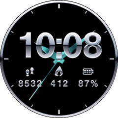

# Liquid Chrome watch face (Amazfit / Zepp OS)

A polished-chrome hybrid face: big chrome digital time, frosted teal chrome hands
(hour, minute and sweeping seconds), plus steps, calories burned and battery
percentage. The background is true black (pixels off on AMOLED), with a chrome bezel
and hour ticks. The always-on display shows dimmed chrome time and dimmed hour and
minute hands, for the lowest power draw.



## Step 0: check which software your watch runs

| Your watch | Software | Which route |
|---|---|---|
| GTR 3 / 3 Pro, GTS 3, GTR 4, GTS 4, GTR Mini, Balance, Active, Active 2, Bip 5, Cheetah, T-Rex 2/3, Falcon | **Zepp OS** | **Route A**: install this coded project |
| **GTR 2, GTR 2e, GTS 2, GTS 2e, GTS 2 mini**, Bip U, Pop | Older Amazfit OS | **Route B**: rebuild it in Watch Face Maker with these images |

On the watch, go to Settings → About. If the system version mentions Zepp OS, use Route A.

This project targets **round** screens. On square ones (GTS 3/4, Bip 5, Active
square), the layout needs moving. The images themselves still work.

---

## Route A: install the coded face (Zepp OS watches)

Plan on about 20 minutes the first time. You need:
- a **computer** (Windows or Mac)
- your **phone** with the **Zepp app**, already paired to the watch
- the phone and computer both online. The face goes computer → Zepp's servers → phone → watch, so they don't need to share Wi-Fi.

### Step 1: Install Node.js on the computer
1. Go to **nodejs.org** and download the **LTS** version (the left button).
2. Run the installer and click **Next** through it with the default options.
3. Open a terminal:
   - **Windows:** Start menu → type `PowerShell` → open **Windows PowerShell**.
   - **Mac:** press Cmd + Space → type `Terminal` → Enter.
4. Check it worked:
   ```
   node -v
   ```
   You should see a version like `v20.x.x`. If you get "not recognized" on Windows,
   close PowerShell and open it again.

### Step 2: Install Zepp's tool (Zeus CLI)
```
npm install -g @zeppos/zeus-cli
zeus -v
```
`zeus -v` printing a version number means it's installed.
- **Mac "permission denied":** run `sudo npm install -g @zeppos/zeus-cli` and type your Mac password. The password won't show as you type.
- **Windows "running scripts is disabled":** run
  `Set-ExecutionPolicy -Scope CurrentUser RemoteSigned`, answer `Y`, then try again.

### Step 3: Download this watch face
1. Open **github.com/hachtel24/pickle-time** in a browser.
2. Click the branch dropdown (it says **main**) and choose **chrome-watchface**.
3. Click the green **Code** button → **Download ZIP**.
4. Unzip it. On Windows, right-click → **Extract All**. On a Mac, double-click it.
5. Inside, find the **`chrome-watchface`** folder: the one containing `app.json`.
6. Point the terminal at that folder. Type `cd ` (with a space after it), drag the
   folder into the terminal window, and press Enter.
   Then check you're in the right place:
   ```
   ls
   ```
   You should see `app.json`, `app.js`, `assets` and `watchface`.

### Step 4: Turn on Developer Mode in the Zepp app (phone)
1. Open the Zepp app → **Profile** (bottom right) → **Settings** → **About**.
2. Tap the **Zepp logo 7 times** in a row. A message confirms Developer Mode is on.
3. Go back to **Profile** → **Settings**. A new **Developer Mode** entry is now there,
   and inside it is a **Scan** button. You'll use that in step 7.

### Step 5: Get an app ID for the face
1. On the computer, go to **console.zepp.com** and sign in with the **same Zepp account**
   your phone app uses.
2. Create a new application and choose **Watch Face** as the type. Name it **Liquid Chrome**.
3. Copy the **App ID** number it gives you.
4. Open `app.json` in any text editor (Notepad or TextEdit is fine) and replace the
   placeholder:
   ```
   "appId": 1000001,
   ```
   with your number, keeping the comma, for example `"appId": 1234567,`. Save the file.

### Step 6: Sign in and build the preview
In the terminal, still in the `chrome-watchface` folder:
```
zeus login
```
A browser window opens. Sign in with the same Zepp account, then go back to the terminal.
```
zeus preview
```
- Use the arrow keys to pick **your exact watch model**, then press Enter.
- Zeus builds the face and prints a **QR code** in the terminal. If the QR code looks
  squashed, make the terminal window bigger and run `zeus preview` again.

### Step 7: Scan the QR code onto the watch
1. Keep the watch close to the phone, with Bluetooth on and the Zepp app open.
2. In the Zepp app: **Profile** → **Settings** → **Developer Mode** → **Scan**.
3. Point the phone camera at the QR code on the computer screen.
4. The Zepp app downloads the face and pushes it to the watch. Keep the app open
   until it reports success, which usually takes under a minute.

### Step 8: Switch the watch to it
- **On the watch:** press and hold the current watch face → swipe to **Liquid Chrome** → tap it.
- **Or in the Zepp app:** Profile → your watch → **Watch Face** → find **Liquid Chrome**.

### Checklist once it's on the watch
- The hands match the digital time, and the second hand sweeps.
- Steps, calories and battery show your real numbers.
- Let the screen time out with always-on display enabled (watch: Settings → Display →
  Always-on display). You should see dim chrome time and dim teal hands, with no second hand.

### If something goes wrong
| Problem | Fix |
|---|---|
| `zeus: command not found` | Close and reopen the terminal. If it still fails, repeat step 2. |
| `zeus preview` says not logged in | Run `zeus login` again, using the same account as the phone. |
| Error about `appId` | Check step 5: the number has no quotes, and the comma is still there. |
| Scan does nothing or times out | Sign in to the phone and computer with the same Zepp account, then run `zeus preview` again for a fresh code. Codes expire. |
| Face installs but items are off-position | Send me a photo of the watch. The positions are the numbers at the top of `watchface/index.js`. |
| Hands are offset from the centre | Same fix: check `CENTER` and the `HANDS` pivot numbers in `watchface/index.js`. |

To keep an installable copy, `zeus build` writes a package to `dist/`. That package is
also what you'd upload if you ever publish the face in the Zepp store.

### What the code does (`watchface/index.js`)
- `IMG_TIME` draws the hours and minutes from the chrome digit images, with the colon
  as the hour's "unit" image.
- `TIME_POINTER` draws the **frosted teal chrome hands**, layered just above the background so the digits and stats sit on top of them (hour, minute and a sweeping second
  hand) plus a centre cap. The watch rotates each hand image around its pivot point
  (`posX` / `posY`), so it stays in sync with the system clock and needs no timers.
- Three `TEXT_IMG` widgets are bound to `hmUI.data_type.STEP`, `CAL` and `BATTERY`, so
  the watch fills in the live values itself. Battery gets a chrome `%` sign.
- `show_level: ONLY_NORMAL` keeps the full face to the normal screen. A second `IMG_TIME`
  and `TIME_POINTER`, with `ONAL_AOD` and dimmed images, handle the always-on display.
- `px()` scales the 480 px design to your watch's real resolution.

---

## Route B: GTR 2 / GTS 2 (Watch Face Maker, no code)

These watches can't run coded faces, but the same chrome images work in Zepp's free
browser tool, **Watch Face Maker** (linked from Zepp's developer docs).

1. Open Watch Face Maker, sign in, and pick your exact watch model.
2. **Background:** upload `assets/common.r/bg.png`. For the GTR 2 (454 × 454), let the
   tool scale it. For the square GTS 2, use a plain black background and skip the bezel.
3. **Time:** add a digital time element and upload `time/0.png` … `time/9.png` as the
   digit images and `time/colon.png` as the separator.
4. **Steps / Calories / Battery:** add each data element, upload `data/0.png` …
   `data/9.png` as its digits, put the matching icon from `icons/` above it, and
   use `data/percent.png` as the battery's unit.
5. **Hands:** add an analog **pointer** element and upload `hands/hour.png`, `hands/minute.png`
   and `hands/second.png`. Set each one's rotation centre to its pivot from `layout.json`
   (`HANDS` → `posX` / `posY`, e.g. hour = 22, 130) and use `hands/cap.png` as the centre cover.
6. **Always-on display:** use `time_aod/`, `hands/hour_aod.png` and `hands/minute_aod.png`.
7. Click **Install / QR code** and scan it with the Zepp app to load it on the watch.

---

## Remaking or restyling the art

Every image is generated by `tools/gen_assets.py`: the digits use the same helvetiker
bold font as the Liquid Chrome videos, shaded as chrome.

```
pip install numpy pillow
python tools/gen_assets.py helvetiker_bold.typeface.json assets/common.r preview.png
```
(`helvetiker_bold.typeface.json` comes with three.js under `examples/fonts/`.) Change
the colours in `env()` to retint the chrome, for example a Seahawks action-green horizon.
The hands use `env_teal()` (the `TSKY` / `THOR` / `TGND` colours) and the `frosted()` settings:
raise `spec_pow` for shinier hands, or lower `grain` for less frost.
If you change digit sizes, update the constants at the top of `watchface/index.js` to
match the new `layout.json`.

## Status
- Checked: the JavaScript and app.json parse, all 43 referenced images exist, the image
  sizes match the layout constants, and no digit image is cropped. The `TIME_POINTER`
  property names match the watch face template that ships inside Zepp's own Zeus CLI.
- **Not yet tested on a watch or in Zepp's simulator.** The Zeus build needs Zepp's
  servers, which weren't reachable from where this was made. The first real test is
  step 6 above. If anything is off on your model, it will most likely be positions, which
  are the constants at the top of `watchface/index.js`.
